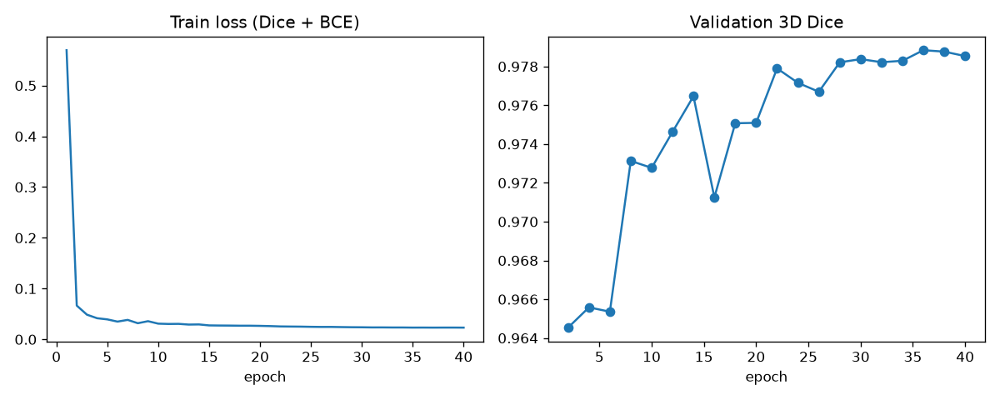

# Femur Segmentation from CT: 2D U-Net vs MONAI 3D U-Net

A reproducible pipeline that segments the femur on CT with two models, a 2D U-Net written from scratch in PyTorch and a 3D residual
U-Net from [MONAI](https://monai.io), evaluates them per patient in 3D (Dice, IoU, HD95, ASD, in mm) on identical patients, and exports smooth STL meshes.

## Results

Test set: 12 patients, split by patient (56 train / 12 val / 12 test of 80 patients).

### 2D U-Net

Best checkpoint chosen on validation (mean 3D Dice 0.9788 at epoch 36 of 40).

| Prediction | Dice | IoU | HD95 (mm) | ASD (mm) | Precision | Recall |
|---|---|---|---|---|---|---|
| Raw (threshold 0.5) | 0.9778 +/- 0.0120 | 0.9568 +/- 0.0228 | 9.50 +/- 24.78 | 0.93 +/- 1.87 | 0.9780 | 0.9777 |
| + connected-component clean-up | 0.9796 +/- 0.0115 | 0.9602 +/- 0.0218 | 2.29 +/- 1.70 | 0.38 +/- 0.20 | 0.9816 | 0.9777 |

Per-patient numbers: [`results/metrics_raw.csv`](results/metrics_raw.csv),
[`results/metrics_post.csv`](results/metrics_post.csv).




### MONAI 3D U-Net

Best checkpoint chosen on validation (mean 3D Dice 0.9787 at epoch 95 of 100). Scored with the same `src/evaluate.py`,
on raw predictions and after the same connected-component clean-up as the 2D model.

| Prediction | Dice | IoU | HD95 (mm) | ASD (mm) | Precision | Recall |
|---|---|---|---|---|---|---|
| Raw (threshold 0.5) | 0.9760 +/- 0.0176 | 0.9537 +/- 0.0324 | 21.33 +/- 36.60 | 1.54 +/- 1.61 | 0.9707 | 0.9819 |
| + connected-component clean-up | 0.9830 +/- 0.0082 | 0.9666 +/- 0.0157 | 1.96 +/- 0.97 | 0.33 +/- 0.15 | 0.9840 | 0.9819 |


For the post-processed 3D model, the three weakest patients by Dice are s0358 (0.9668), s1230 (0.9707) and s0646 (0.9720); s0646 also has the largest HD95 (4.50 mm).
These are the same three patients that are weakest for the 2D model.

### 2D vs 3D (post-processed, paired by patient)

| Metric | 2D U-Net | MONAI 3D | Median 2D / 3D | Wilcoxon p |
|---|---|---|---|---|
| Dice | 0.9796 +/- 0.0115 | 0.9830 +/- 0.0082 | 0.985 / 0.987 | 0.021 |
| HD95 (mm) | 2.29 +/- 1.70 | 1.96 +/- 0.97 | 1.500 / 1.500 | 0.250 |
| ASD (mm) | 0.383 +/- 0.199 | 0.326 +/- 0.145 | 0.325 / 0.268 | 0.027 |

- The 3D model has the higher Dice in 10 of 12 patients and the lower ASD in 10 of 12, but the lower HD95 in only 3 of 12 (it ties in the other 9).
  On the easy cases the two models are nearly identical, and the 2D model is slightly better on s0366 and s0401.
- HD95 values are quantised by the voxel size (1.5 mm), so many patients tie at exactly 1.50 mm and the HD95 difference is not significant.
- With 12 test patients, unadjusted p-values over three metrics, and a single training run per model, treat the differences as indicative only.


## Quickstart

### 1. Environment
```bash
conda create -n femur python=3.11 -y && conda activate femur
# PyTorch with CUDA: use the command for your system from https://pytorch.org/get-started/locally/
pip install -r requirements.txt
python -c "import torch; print(torch.cuda.is_available())"
```
The MONAI model additionally needs `pip install monai`. Run everything in one environment: `src.infer_monai` imports both
MONAI and SimpleITK, and fails with `ModuleNotFoundError` if either is missing.

### 2. Data
Dataset: **TotalSegmentator CT v2.0.1**, Zenodo record [10047292](https://zenodo.org/records/10047292)
(1228 scans, 117 structures, about 23 GB zip). Check the licence on the Zenodo page and cite:
Wasserthal et al., *TotalSegmentator: robust segmentation of 104 anatomic structures in CT images*, Radiology: Artificial Intelligence, 2023.

This script extracts only the femur masks, keeps cases with at least `--min_extent_mm` of visible femur (measured head-to-foot, both femurs merged),
and extracts the CTs of just those cases:
```bash
python tools/extract_subset.py PATH/TO/Totalsegmentator_dataset_v201.zip data/raw --num_cases 120 --min_extent_mm 100 --extract
```

### 3. Preprocess, train, evaluate (2D U-Net)
```bash
python -m src.prepare_data --config configs/default.yaml        # writes data/processed/ and splits.json
python -m src.train --config configs/default.yaml                # full training

python -m src.infer    --config configs/default.yaml --split test
python -m src.evaluate --config configs/default.yaml --split test --pred_dir runs/unet2d_base32/predictions/test/raw
python -m src.evaluate --config configs/default.yaml --split test --pred_dir runs/unet2d_base32/predictions/test/post
python -m src.make_figures --config configs/default.yaml --split test --pred_dir runs/unet2d_base32/predictions/test/post --out_dir figures
python -m src.export_mesh  --mask runs/unet2d_base32/predictions/test/post/<case>.nii.gz --out_dir meshes/<case>
```

### 4. MONAI 3D U-Net and comparison

Trained on the **same preprocessed volumes and the same `splits.json`** as the 2D model (run `prepare_data` first),
and scored with the **same `src/evaluate.py`**, so both models are compared on identical patients with identical metrics.

```bash
pip install monai
python -m src.train_monai --config configs/monai3d.yaml                # full training (resume with --resume)
python -m src.infer_monai --config configs/monai3d.yaml --split test   # sliding-window inference, raw + post-processed NIfTI
python -m src.evaluate --config configs/default.yaml --split test --pred_dir runs/unet3d_monai/predictions/test/post
python -m src.compare --a runs/unet2d_base32/predictions/test/post/metrics.csv --a_name "2D U-Net" \
                      --b runs/unet3d_monai/predictions/test/post/metrics.csv --b_name "MONAI 3D"
```

- **Model:** MONAI residual 3D `UNet` (channels 16-32-64-128-256, instance norm, 4.81 M parameters) or `SegResNet`
  (`model.name: segresnet`), one output logit, Dice + cross-entropy loss (`DiceCELoss`).
- **Training:** random 96x96x96 patches (half centred on the femur, half on background), 2 patches per step, 224 steps per epoch,
  rotation / scale / left-right flip / intensity / noise augmentation, AdamW with cosine schedule, mixed precision, 100 epochs
  (about 35 s per epoch on a laptop GPU). Full-volume validation runs every 5 epochs (`val_every`), so the other epochs log `val dice nan`.
- **Inference:** sliding window (overlap 0.5, Gaussian blending) over the full volume, about 8 s for the 12 test volumes,
  then the same component clean-up as the 2D model.
  