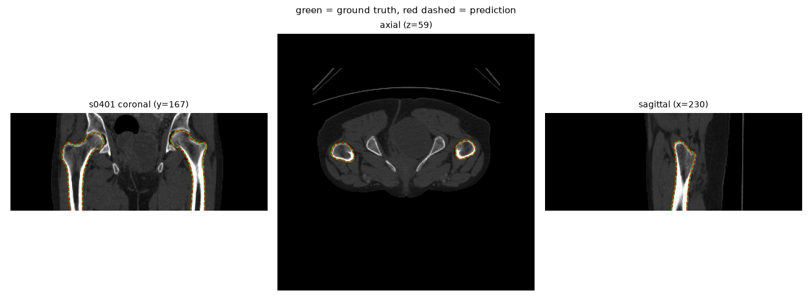

# Femur Segmentation from CT with a 2D U-Net

A reproducible pipeline that segments the femur on CT slices with a 2D U-Net written from scratch in PyTorch, evaluates it
per patient in 3D (Dice, IoU, HD95, ASD, in mm) and exports smooth STL meshes.

This is a learning project. The labels are TotalSegmentator's own model-assisted segmentations, and validation is internal to one dataset.

## Results

Test set: 12 patients, split by patient (56 train / 12 val / 12 test of 80 patients). Mean +/- std over patients.
Best checkpoint chosen on validation (mean 3D Dice 0.9788 at epoch 36 of 40).

| Prediction | Dice | IoU | HD95 (mm) | ASD (mm) | Precision | Recall |
|---|---|---|---|---|---|---|
| Raw (threshold 0.5) | 0.9778 +/- 0.0120 | 0.9568 +/- 0.0228 | 9.50 +/- 24.78 | 0.93 +/- 1.87 | 0.9780 | 0.9777 |
| + connected-component clean-up | 0.9796 +/- 0.0115 | 0.9602 +/- 0.0218 | 2.29 +/- 1.70 | 0.38 +/- 0.20 | 0.9816 | 0.9777 |

Per-patient numbers: [`results/metrics_raw.csv`](results/metrics_raw.csv),
[`results/metrics_post.csv`](results/metrics_post.csv).




## Pipeline

```
TotalSegmentator CT + femur masks
  -> tools/extract_subset.py : pick cases with enough visible femur, extract only those CTs
  -> src.prepare_data        : merge L/R femur, LPS reorient, resample to 1.5 mm, crop z around femur,
                               centre-crop to 320x320, patient-level split (splits.json)
  -> src.train               : 2D U-Net, Dice + BCE loss, AdamW, cosine LR, AMP, augmentation
  -> src.infer               : predict every axial slice, stack to 3D, threshold, component clean-up
  -> src.evaluate            : Dice / IoU / HD95 / ASD / precision / recall per patient, in mm
  -> src.export_mesh         : marching cubes -> Taubin smoothing -> STL
  -> src.make_figures        : CT + ground truth (green) + prediction (red) overlays
```

## Quickstart

### 1. Environment
```bash
conda create -n femur python=3.11 -y && conda activate femur
# PyTorch with CUDA: use the command for your system from https://pytorch.org/get-started/locally/
pip install -r requirements.txt
python -c "import torch; print(torch.cuda.is_available())"
```

### 2. Data
Dataset: **TotalSegmentator CT v2.0.1**, Zenodo record [10047292](https://zenodo.org/records/10047292)
(1228 scans, 117 structures, about 23 GB zip). Check the licence on the Zenodo page and cite:
Wasserthal et al., *TotalSegmentator: robust segmentation of 104 anatomic structures in CT images*, Radiology: Artificial Intelligence, 2023.

This script extracts only the femur masks, keeps cases with at least `--min_extent_mm` of visible femur (measured head-to-foot, both femurs merged),
and extracts the CTs of just those cases:
```bash
python tools/extract_subset.py PATH/TO/Totalsegmentator_dataset_v201.zip data/raw --num_cases 120 --min_extent_mm 100 --extract
```

### 3. Preprocess, train, evaluate
```bash
python -m src.prepare_data --config configs/default.yaml        # writes data/processed/ and splits.json
python -m src.train --config configs/default.yaml --overfit      # sanity check: Dice should approach 1.0
python -m src.train --config configs/default.yaml                # full training

python -m src.infer    --config configs/default.yaml --split test
python -m src.evaluate --config configs/default.yaml --split test --pred_dir runs/unet2d_base32/predictions/test/raw
python -m src.evaluate --config configs/default.yaml --split test --pred_dir runs/unet2d_base32/predictions/test/post
python -m src.make_figures --config configs/default.yaml --split test --pred_dir runs/unet2d_base32/predictions/test/post --out_dir figures
python -m src.export_mesh  --mask runs/unet2d_base32/predictions/test/post/<case>.nii.gz --out_dir meshes/<case>
```
